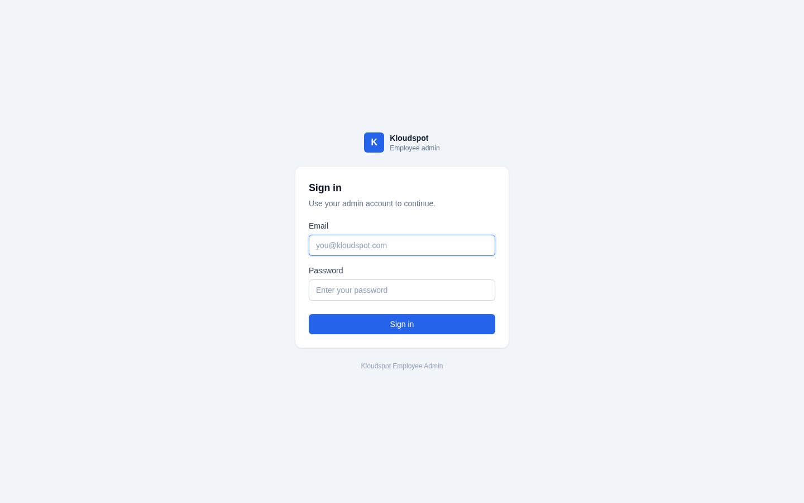
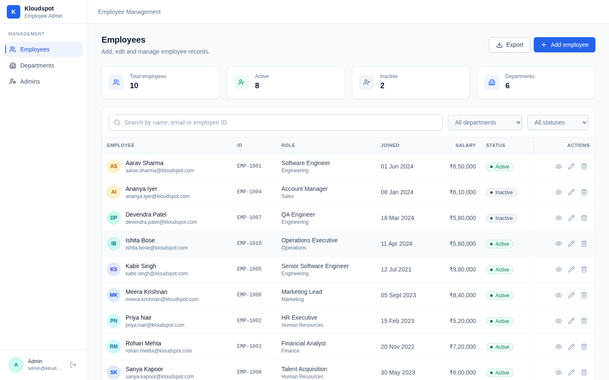
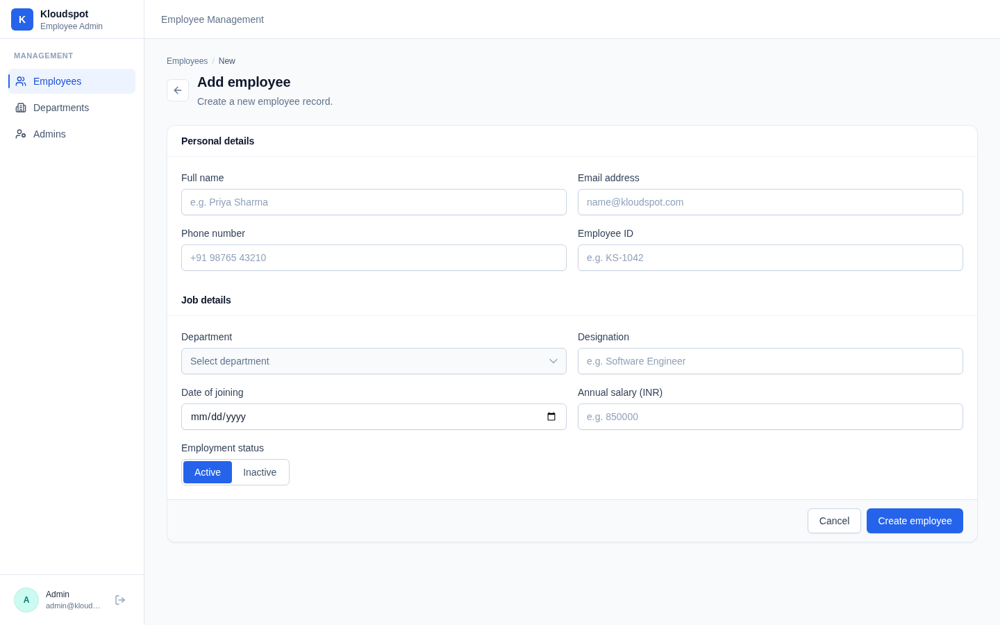
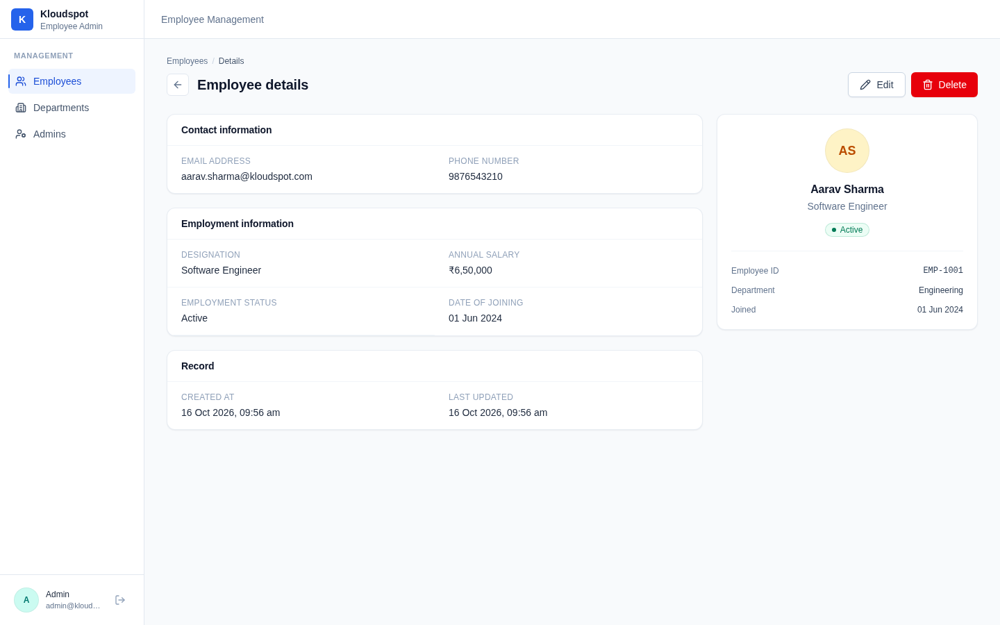
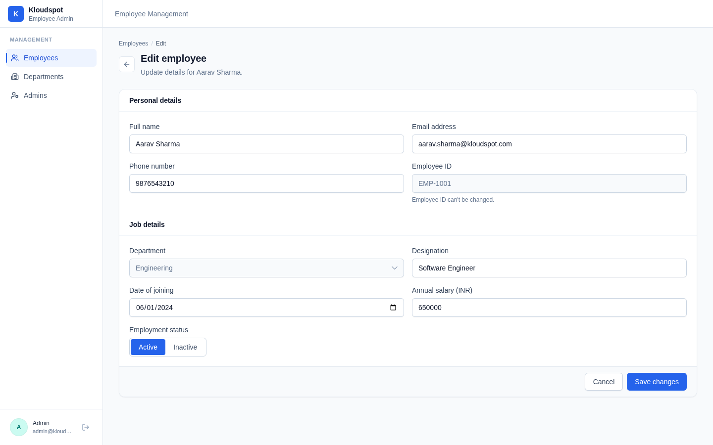
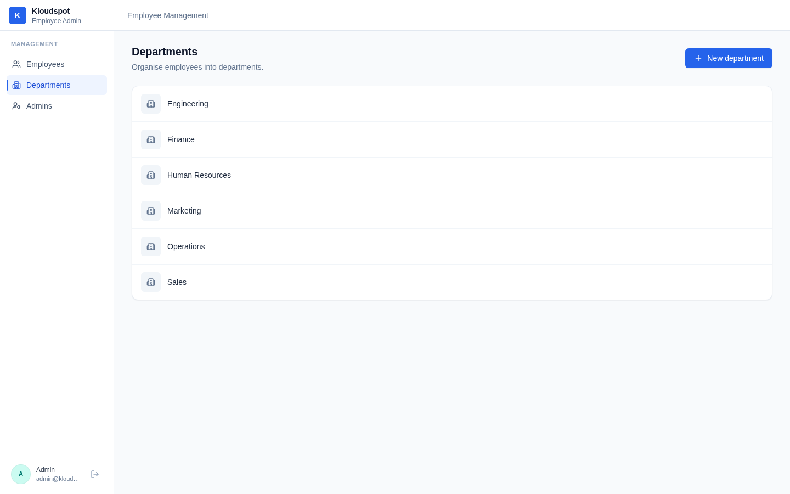
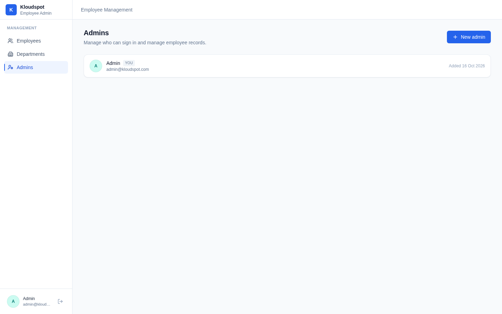
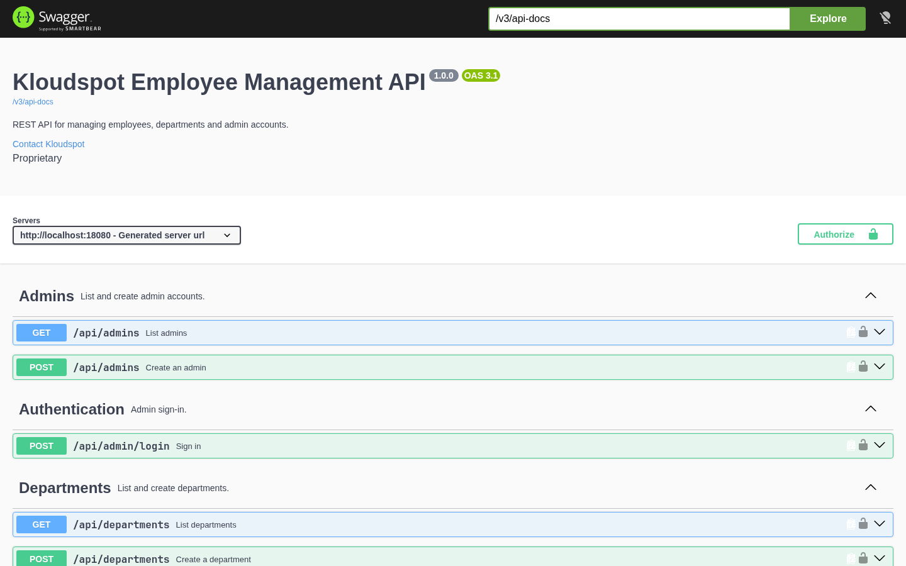

# Kloudspot Employee Management System

A full-stack employee management application. Admins sign in, then create, view,
edit, search, filter and export employee records, and manage departments and other
admin accounts.

- **Backend:** Spring Boot 4 (Java 21) REST API with JWT auth and PostgreSQL.
- **Frontend:** React 19 + TypeScript + Vite + Tailwind CSS.
- **API docs:** OpenAPI 3 / Swagger UI (springdoc).

---

## Features

- Admin sign-in with JWT (BCrypt-hashed passwords).
- Employee CRUD with delete confirmation.
- Search by name, email or employee code.
- Filter by department and employment status.
- Pagination (server side).
- CSV export of the current filter.
- Department management (including inline creation from the employee form).
- Admin management (create additional admins).
- Responsive UI with a collapsible sidebar.

---

## Tech Stack

| Layer     | Technology |
|-----------|------------|
| Backend   | Java 21, Spring Boot 4.1, Spring Web, Spring Data JPA, Spring Security, JJWT |
| Database  | PostgreSQL |
| API docs  | springdoc-openapi (Swagger UI) |
| Build     | Maven (wrapper included) |
| Frontend  | React 19, TypeScript, Vite, Tailwind CSS v4, React Router, lucide-react |
| Tests     | JUnit 5, Mockito (backend), Vitest + Testing Library (frontend) |
| Container | Docker, Docker Compose, nginx |

---

## Project Structure

```
.
├── backend/            Spring Boot REST API
│   ├── db/schema.sql   Reference PostgreSQL schema
│   ├── src/main/java/  Controllers, services, repositories, security, DTOs
│   ├── src/test/java/  Unit tests (Mockito) and integration tests (MockMvc)
│   ├── postman/        Postman collection
│   └── pom.xml
├── frontend/           React single page app
│   ├── src/api/        API client (real REST + local fallback)
│   ├── src/components/ UI components
│   ├── src/pages/      Route screens
│   └── package.json
├── docs/screenshots/   Screenshots of the running application
├── docker-compose.yml  Postgres + backend + frontend
├── run.sh              Wrapper around Docker Compose (see Troubleshooting)
└── README.md
```

---

## Prerequisites

- **Docker route (recommended):** just Docker and Docker Compose. Nothing else.
- **Manual route (optional):** Java 21+, Maven 3.9+ (or the bundled `./mvnw`),
  Node.js 20+, and a PostgreSQL 14+ database.

---

## Quick Start (Docker)

Everything is self-contained: one command pulls PostgreSQL, creates the database,
wires the backend to it, and serves the app. No `.env`, no external database, and
no code changes are required.

```bash
docker compose up --build
```

On some Docker installations (those using the containerd image store) this can
fail with `No such image`; in that case use the bundled wrapper instead, which is
otherwise identical:

```bash
./run.sh
```

Then open:

- Frontend: http://localhost:3000
- API:      http://localhost:8080
- Swagger:  http://localhost:8080/swagger-ui.html

Sign in with the seeded admin (see [Demo credentials](#demo-credentials)).

The first request after a cold start may take a few seconds while the backend
finishes starting; the frontend waits for the backend health check, so the UI is
ready as soon as it is reachable.

### Managing the stack

```bash
docker compose ps           # service status (look for "healthy")
docker compose logs -f      # follow logs
docker compose down         # stop, keep the database volume
docker compose down -v      # stop and wipe the database (fresh start)
```

Data is stored in the `db-data` Docker volume and survives `docker compose down`.
Use `down -v` to reset to a clean database.

To change ports or values, copy `.env.example` to `.env` and edit it (all values
already have working defaults).

### Troubleshooting

**`Error response from daemon: No such image: ...-backend:latest` right after
`docker compose up --build`.** This is a known bug in Docker Compose/buildx when
Docker is configured with the containerd image store (`docker info` shows
`driver-type: io.containerd.snapshotter.v1`); the build succeeds but the image
tag cannot be resolved. Any of the following fixes it:

- Use the wrapper: `./run.sh` (sets `BUILDX_NO_DEFAULT_ATTESTATIONS=1` and runs
  `docker compose up --build`).
- Or build and start in two steps: `docker compose build && docker compose up -d`.
- Or run with the variable set directly:
  `BUILDX_NO_DEFAULT_ATTESTATIONS=1 docker compose up --build`.
- Or update Docker Compose/buildx to a version with the upstream fix.

**`failed to bind host port ... address already in use`.** Another service is
already using the port (the defaults are `8080` for the API and `3000` for the
UI). Either stop that service, or choose free ports in a `.env`:

```bash
echo "BACKEND_PORT=18080"  >> .env
echo "FRONTEND_PORT=13000" >> .env
docker compose up --build
```

---

## Alternative: Run without Docker

The Docker route above is the easiest way to run everything. If you prefer to run
the services directly (for example while developing a single side), follow the
steps below. This requires a PostgreSQL database you provide yourself.

### 1. Backend

Create a PostgreSQL database, then provide the connection details. Easiest is to
copy the example file and source it:

```bash
cd backend
cp .env.example .env
set -a && source .env && set +a      # export the variables
./mvnw spring-boot:run
```

The API starts on http://localhost:8080. On first run an admin is seeded
(`admin@kloudspot.com` / `admin123`) and the schema is created automatically
(`spring.jpa.hibernate.ddl-auto=update`).

To run with the production profile (database and CORS settings are then required
from the environment):

```bash
SPRING_PROFILES_ACTIVE=prod ./mvnw spring-boot:run
```

### 2. Frontend

```bash
cd frontend
npm install
cp .env.example .env.development     # defaults already point at :8080
npm run dev
```

The app runs on http://localhost:5173.

> The frontend talks to the REST API by default (`VITE_USE_LOCAL=false`).
> Set `VITE_USE_LOCAL=true` to run entirely from an in-browser fallback with no
> backend (handy for a quick UI preview).

---

## Environment Variables

### Backend

| Variable | Description | Default |
|----------|-------------|---------|
| `PORT` | HTTP port | `8080` |
| `DB_URL` | JDBC URL, e.g. `jdbc:postgresql://localhost:5432/kloudspot` | required |
| `DB_USERNAME` | Database user | required |
| `DB_PASSWORD` | Database password | required |
| `JWT_SECRET` | Signing key, 32+ characters. Optional; if unset a random secret is generated at startup (sessions reset on restart) | _auto-generated_ |
| `JWT_EXPIRATION_MS` | Token lifetime in ms | `86400000` (24h) |
| `CORS_ALLOWED_ORIGINS` | Comma separated browser origins | `http://localhost:5173,http://localhost:3000` |
| `OPENAPI_ENABLED` | Serve Swagger UI | `true` (dev), `false` (prod) |
| `SPRING_PROFILES_ACTIVE` | Set to `prod` for production | _(unset)_ |

### Frontend

| Variable | Description | Default |
|----------|-------------|---------|
| `VITE_SERVER_URL` | Base URL of the API | `http://localhost:8080` |
| `VITE_USE_LOCAL` | `true` to use the offline fallback | `false` |

---

## Demo Credentials

```
Email:    admin@kloudspot.com
Password: admin123
```

---

## API Reference

Base URL: `http://localhost:8080`. All endpoints except `login` and `health`
require `Authorization: Bearer <token>`.

| Method | Path | Description |
|--------|------|-------------|
| `POST` | `/api/admin/login` | Sign in, returns a JWT |
| `GET` | `/api/health` | Health check |
| `GET` | `/api/emp?page&size&search&department&status` | List employees (paginated, filtered) |
| `POST` | `/api/emp/add` | Create an employee |
| `GET` | `/api/emp/{id}` | Get an employee |
| `PATCH` | `/api/emp/{id}` | Update an employee |
| `DELETE` | `/api/emp/{id}` | Delete an employee |
| `GET` | `/api/emp/export?search&department&status` | Export matching employees as CSV |
| `GET` | `/api/departments` | List departments |
| `POST` | `/api/departments` | Create a department |
| `GET` | `/api/admins` | List admins |
| `POST` | `/api/admins` | Create an admin |

### Swagger / OpenAPI

- Swagger UI: http://localhost:8080/swagger-ui.html
- OpenAPI JSON: http://localhost:8080/v3/api-docs

Use the **Authorize** button to paste a JWT and try the protected endpoints.

A ready-made Postman collection is available at
`backend/postman/kloudspot.postman_collection.json`.

---

## Screenshots

| | |
|---|---|
|  |  |
| Sign in | Employees list (search, filters, pagination) |
|  |  |
| Add employee | Employee details |
|  |  |
| Edit employee | Departments |
|  |  |
| Admins | Swagger UI |

---

## Database Schema

```
Admin
  id         uuid (pk)
  name       string
  email      string (unique)
  password   string (bcrypt)
  created_at datetime

Department
  id         uuid (pk)
  name       string (unique)
  created_by uuid  -> Admin
  created_at datetime
  updated_at datetime

Employee
  id               uuid (pk)
  emp_id           string (unique)
  full_name        string
  email            string (unique)
  phone_number     string
  department_id    uuid -> Department
  designation      string
  date_of_joining  date
  salary           numeric(12,2)
  employment_status boolean  (true = Active, false = Inactive)
  created_by       uuid -> Admin
  created_at       datetime
  updated_at       datetime
  updated_by       uuid -> Admin
```

Hibernate creates this automatically (`ddl-auto=update`). A runnable, hand-named
version of the same DDL is provided at `backend/db/schema.sql` for teams that
prefer to provision the database ahead of time.

---

## Testing

### Backend

```bash
cd backend
./mvnw test
```

Covers service-layer business logic with Mockito (auth, employees, departments,
admins, CSV export) plus controller/integration tests driven through MockMvc.

### Frontend

```bash
cd frontend
npm test
npm run lint
npm run build
```

---

## Deployment Notes

- The Docker Compose stack runs the backend with the `prod` profile
  (`SPRING_PROFILES_ACTIVE=prod`), and every service has a health check plus a
  `restart: unless-stopped` policy.
- **JWT secret:** if `JWT_SECRET` is not set, a random secret is generated at
  startup so no insecure default is ever shipped. For stable sessions across
  restarts (and for multiple replicas), set a fixed `JWT_SECRET` of 32+ characters
  via `.env`.
- **CORS:** when serving the frontend from a real domain, set `CORS_ALLOWED_ORIGINS`
  to that origin; the default derives from `FRONTEND_PORT` for local use.
- Swagger UI is on by default in the Compose stack for demonstration; set
  `OPENAPI_ENABLED=false` to disable it.
- The frontend is served by nginx, which also proxies `/api` to the backend, so the
  API base URL is same-origin.
- Build the backend jar with `./mvnw clean package` and the frontend with
  `npm run build`.
